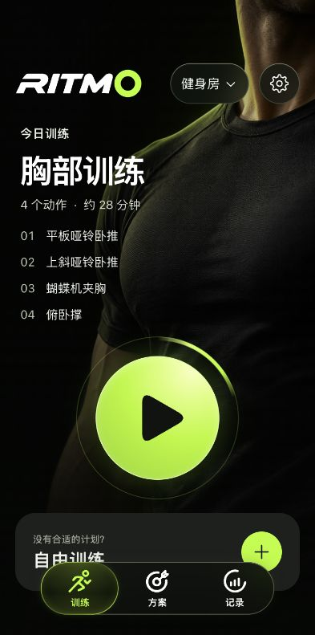
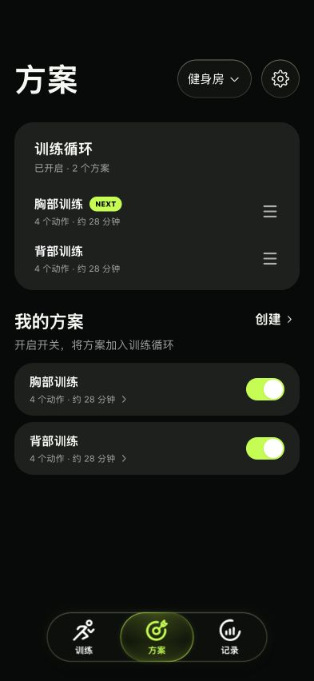
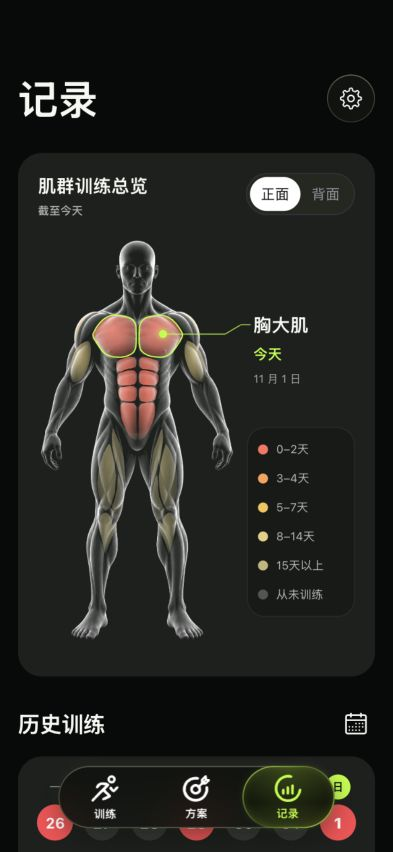

# RITMO · 找到属于你的训练节奏


RITMO 是一款面向力量训练新手的个人运动健身 Web App。从个人力量训练出发，连接训练方案、动作示范、训练节奏与记录，用连续的圆形交互建立清晰的训练体验。

**V1.8 个人使用版 MVP · 私有源码仓库 · 独立公开 Demo**

我负责产品定义、交互、品牌、界面、视觉判断与验收；AI 协助分析讨论、代码实现、素材制作和验证。项目从设计探索推进到可在 iPhone 主屏幕实际使用的网页 App。

- [电脑／手机体验与安装说明](docs/DEMO.md)
- [项目背景与完整设计过程](docs/CASE_STUDY.md)
- [版本、数据与素材边界](docs/RELEASE.md)

## 直接体验

[**打开 RITMO 在线 Demo**](https://ritmo-portfolio-demo.xiemingjian2024.chatgpt.site/)

**电脑：** 浏览器打开 Demo，体验「训练、方案、记录」三个 Tab。桌面显示手机样机，小屏使用完整移动布局。

**iPhone：** 在 Safari 打开 Demo → 分享 → 添加到主屏幕 → 添加。之后从 RITMO 图标启动，以独立网页 App 窗口使用，无需 Apple Developer Program、App Store 或 IPA。

公开 Demo 使用独立演示数据，后续修改保存在访问者自己的浏览器中，不读取或改写项目所有者的个人训练记录。源码继续保持私有，体验 Demo 不需要仓库权限。

## 为什么做 RITMO

刚开始健身时，我常常要确认动作怎么做、眼前的器械够不够用，还得停下来翻手机。我想借助 AI，为自己做一个训练 App，也验证能否把设计想法真正用起来。

目标是降低完成一次训练所需的判断与操作：开练前有时间放好手机、拿稳器械；练的时候能看动作示范与进度；组间休息自然衔接；练完可以回看练过哪里、距今多久。

## 体验框架

| 环节 | 实际能力 |
| --- | --- |
| 训练安排 | 家里／健身房与器械管理，六肌群推荐，自由训练，自定义方案与循环 |
| 准备开始 | 热身 → 力量 → 拉伸，3·2·1 倒计时，动作间手动 START |
| 训练执行 | 图片／Sequence、计次与计时圆环、组间休息、左右侧自动切换 |
| 训练控制 | 点圆环暂停，继续、调整参数、跳过动作或阶段、结束；中断后从首页选择继续或重开 |
| 训练回顾 | 已完成力量组、时长、日历、独立 Session、正背面肌群近期训练分布 |
| 手机使用 | HTTPS、主屏幕图标、独立窗口、Safe Area 与刷新恢复 |

胸、背、肩、手臂、臀腿、核心均有个人版流程。居家推荐使用六段个人参考视频整理的动作与确认替代方案；健身房使用对应器械环境的推荐。

<p>



</p>

## 从 O 到训练里的圆

RITMO 意为「节奏」。字标保留倾斜、切角的动势，以荧光绿正圆 O 建立识别焦点。圆形延伸为连续的操作语言：

**Logo O → PLAY → 3·2·1 → 执行圆环 → 暂停与继续**

共享元素按真实布局动态测量，适配不同尺寸；减少动态效果时跳过非必要动画，计时与训练规则正常保留。完整品牌、素材管线与 AI 协作过程见 [设计案例](docs/CASE_STUDY.md)。

## 下载源码并在电脑运行

仅对已获本私有仓库访问权限的用户开放。可以通过 GitHub **Code → Download ZIP** 下载，解压后进入包含 `package.json` 的目录；或克隆：

```bash
git clone https://github.com/xiemingjian2024-stack/ritmo-mvp.git
cd ritmo-mvp
npm ci
npm run dev -- --host 0.0.0.0 --port 4173
```

需要 **Node.js 22.12+ 的兼容版本**，建议 Node.js 22 LTS；首次安装需要联网下载依赖。打开 `http://localhost:4173/`。无需 API Key、数据库或付费云服务。

同一 Wi-Fi 下，手机可打开 `http://电脑的局域网IP:4173/` 临时预览，电脑须开机并允许该端口。这是 HTTP 调试，不等同于 HTTPS 主屏幕体验；日常手机体验优先用公开 Demo。

| 入口 | 地址参数 |
| --- | --- |
| 训练 | `/?flow=training` |
| 方案 | `/?flow=plans` |
| 记录 | `/?flow=records` |

## 构建与验证

```bash
npm run check:runtime
node --test tests/*.test.mjs
npm run build
```

静态网页输出到 `dist/client/`，`dist/server/index.js` 提供 Sites Worker 页面回退。`dist/`、`node_modules/` 与本机数据不纳入源码提交。

浏览器交互测试：`npx playwright install chromium` 后运行 `npm run test:runtime`。部分早期研究用例依赖历史隔离报告或本地审核媒体，不能把整个测试目录等同于当前版本全部通过；本次验证范围见 [版本记录](docs/RELEASE.md)。

## 技术实现

React 19、TypeScript、Vite、CSS／SVG／轻量 Web 动画、Radix UI、Playwright。方案、Session、循环位置与中断进度通过浏览器 `localStorage` 保存，无业务数据库或云端同步。

| 代码 | 职责 |
| --- | --- |
| `src/Prototype.tsx` | 页面与训练执行 |
| `src/prototype.css` | 视觉与响应式 |
| `src/personalTrainingLibrary.ts` | 个人视频库与模板 |
| `src/exerciseMedia.ts` | 稳定 ID 与媒体匹配 |
| `src/workoutLifecycle.ts` | 保存与生命周期 |
| `src/mobile/` | 移动容器、弹层与手势 |

## 数据与验证边界

- 正常完成力量训练按原规则保存 Session，NEXT 只推进一次；提前结束记录 partial，不推进 NEXT；拉伸退出保留已保存力量记录。
- 计次来自预设节奏，不是摄像头、Apple Watch 或传感器识别。默认单次 4 秒、力量组间休息 90 秒，可设置；静态计时与左右换侧沿各自动作规则。
- Demo 预置历史用于展示肌群颜色与日历，不是真实训练结果。当前没有已验收的导出导入、Watch 连接或可靠离线冷启动。
- Safari 与主屏幕 Web App 可能使用不同存储；换设备、换域名、清除网站数据不会自动迁移记录。
- 媒体经过设计师视觉确认与基本技术检查，专业教练审校仍独立待审。缺失媒体统一占位。

本仓库供个人项目交接与受邀审阅，未授予代码或媒体的开放再分发许可。素材来源与使用范围保留在对应数据与记录中。
